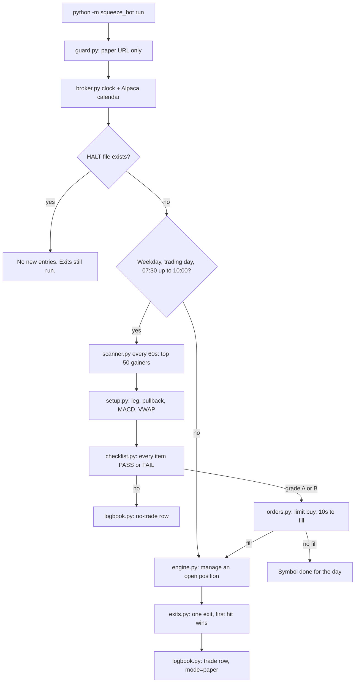

# The Squeeze Lab

A front-side momentum pullback, written as code that will not blink. The bot watches small, fast names in the premarket, waits for one clean dip, and either takes a paper trade or writes down why it didn't. No model sits on the order path. `SPEC.md` is the rule book. This page is how those rules actually run.

All times below are America/New_York. Checklist timestamps in the logs are America/Edmonton. Every number in the examples is made up and labeled that way.

## The pipeline



`squeeze_bot/main.py` is the loop, about once a second. `squeeze_bot/replay.py` walks the same gate and the same exits on historical 1-minute bars and never calls the order methods.

## The idea

A name gaps up on news with a thin float. The first push after that news is the squeeze leg. The bot only wants the first pullback of that push, while the move is still on its front side. Front side means MACD has not yet crossed bearish since the news. A second leg, after a new high of day, is someone else's trade. The symbol is done.

## What the scanner throws out

`squeeze_bot/scanner.py`, weekdays from 07:30:00 until 10:00:00, every 60 seconds. The universe is Alpaca's top 50 stock gainers (`squeeze_bot/broker.py`). The spec never names a universe. This is the one the loop uses.

| Filter | Rule | Why it is here |
| --- | --- | --- |
| Price | Last price `<= $9.00` | Keeps the book in the small-cap pocket the strategy is built for. |
| Day change | `(last - prior close) / prior close >= 50%` | The name has to already be in motion. A quiet stock is not a squeeze. |
| Relative volume | Today's cumulative volume / 30-day average `>= 100` | The move has to be loud versus this name's own history. |
| Float | Under 20 million shares | A small share count is what lets a burst of volume move the price. |
| News | An Alpaca article after the prior session's 16:00, with a URL | The leg is anchored to a real headline, and the URL is what gets logged. |

**Made-up day-change check.** Prior close `$2.00`, last trade `$3.10`. Change = `(3.10 - 2.00) / 2.00 = 0.55`. That passes. `$2.99` on the same close is `0.495` and fails.

Anything uncertain (a missing prior close, a short volume history, two float sources that disagree) becomes grade C in `squeeze_bot/risk.py` and is not traded. A clean rule break is a hard fail: no grade, no trade.

### Relative volume

```
rvol = volume since 04:00 ET today / mean of the prior 30 trading days
```

The numerator adds 1-minute bars from the 04:00 session plus the bar that is still forming (`cumulative_volume`). The scan runs before the open, and Alpaca's daily bars are regular-hours volume, so the live total has to be built from minutes. The denominator ignores today. Fewer than 30 prior sessions means rvol is undefined.

**Made-up rvol.** Today so far: `4,800,000` shares. Each of the last 30 sessions averaged `40,000`. `4,800,000 / 40,000 = 120`. The gate is `>= 100`, so this passes. `3,900,000 / 40,000 = 97.5` fails.

### Float, two sources, then a spreadsheet

`squeeze_bot/floats.py` reads the free Finviz quote page (`Shs Float`) and, if that number is missing, the SEC company-facts series for shares outstanding. When both exist they must agree:

```
gap = abs(finviz - sec) / min(finviz, sec)
```

A gap of exactly 20% still agrees. Above 20%, or both missing, the symbol fails. On agreement the bot keeps the Finviz number.

`float.csv` (`symbol,float,source,ts_mt`, default `/home/box/squeeze-trader/float.csv`) is a cross-check the owner fills in. A row that is present and more than 20% off the resolved number fails. A missing row does not. The bot never writes this file.

**Made-up float.** Finviz `4,000,000`, SEC `4,400,000`. Gap = `400,000 / 4,000,000 = 0.10`. They agree. Float used: `4,000,000`, under the 20 million cap. A csv row of `8,000,000` is a 100% gap and fails. No csv row at all: the `4,000,000` stands.

### News

`first_qualifying_news` keeps articles whose timestamp is strictly after the prior session's 16:00 and that carry a URL. The earliest one is `news_time`. An article stamped exactly at 16:00 does not count. No qualifying article is a fail.

### The exclusions

Still in `scanner.py`. Any one of these is enough.

- **IPO under 90 days.** Age is the earliest daily bar in a 180-day lookback. Day 90 is allowed. If the lookback is truncated and the oldest bar is already 90 days back, the name is treated as not an IPO.
- **Second day.** Prior session was already a `>= 50%` day, close-to-close or on its high, versus the close before that session. The bot wants the first day of the move.
- **Pop-and-fade.** In the 30 calendar days before today, any day that ran up `>= 50%` from the prior close and then gave back `>= 50%` of that gain by the close. Day 30 counts. Day 31 and today do not.
- **LULD halt today.** Alpaca has no halt endpoint, so `is_luld` matches quote conditions and reason codes (`M`, `LULD`, `LUDP`, `T5`, `T12`, and the volatility-pause labels). Unknown status is a no-trade.
- **Red to green.** Session low strictly under the prior close, and the last trade strictly over it. The open-to-green reversal is a different trade.
- **Heavy selling into the pullback.** A red minute (`close < open`; a doji is neither) after the high of day whose volume is strictly greater than the largest green bar of the leg. That tape already said no.

## MACD and VWAP

Both live in `squeeze_bot/indicators.py`.

MACD is 12 / 26 / 9 on 1-minute closes. The moving average is an EMA seeded with a simple average, then updated as one fraction so the seed stays exact:

```
EMA_t = (2 * price_t + (n - 1) * EMA_t-1) / (n + 1)
line   = EMA_12 - EMA_26
signal = EMA_9 of the line
```

A bearish cross is the first bar where the previous line was `>=` the signal and the current line is `<` the signal. Entry wants the line strictly above the signal and strictly above zero (`macd_entry_ok` in `setup.py`).

VWAP resets at 04:00 ET. Each bar contributes its typical price:

```
typical = (high + low + close) / 3
VWAP    = sum(typical * volume) / sum(volume)
```

**Made-up VWAP, two bars, same session.** Bar 1: high `3`, low `1`, close `2`, volume `10`. Typical `2`, VWAP `2`. Bar 2: high `4`, low `2`, close `3`, volume `10`. Typical `3`. VWAP = `(2*10 + 3*10) / 20 = 2.5`. The next session starts the sums over.

## The state machine

`analyze_setup` in `squeeze_bot/setup.py` only looks at closed minutes that start at or after `news_time`.

1. **Building the leg.** Track the high of day. The leg low is the lowest low from the first post-news bar through the bar that printed that high.
2. **First pullback.** The first bar that does not make a strictly higher high starts the pullback. Stop is the lowest low of those pullback bars.
3. **Done (ABCD).** If price then prints a new high of day, the first pullback is over. `done_reason = "abcd"`. The symbol is finished for the day even if it dips again.

Front side is a separate switch. It starts live after the news and dies forever, for that day, on the first bearish MACD cross on a bar that starts at or after `news_time`. A cross that happened before the news does not count. If MACD has not warmed up yet after the news, the front side is uncertain and there is no trade.

The pullback itself has three more tests:

- Average pullback-bar volume `<= 50%` of average leg-bar volume.
- Pullback low strictly above the VWAP of the bar that printed that low.
- Retrace `<= 50%` of the leg: `(HOD - pullback low) / (HOD - leg low)`.

**Made-up leg.** News at 07:50. Leg low `$2.90`, high of day `$4.90`, pullback low `$4.35`. Retrace = `(4.90 - 4.35) / (4.90 - 2.90) = 0.55 / 2.00 = 0.275`. Under one half, so the depth is fine. A pullback low of `$3.90` would be `(4.90 - 3.90) / 2.00 = 0.50`, still allowed. `$3.89` would be over the half and out.

## The trigger, then the limit

Setup conditions are judged on the last **closed** bar. The trigger is intrabar, in `triggered`: the last trade must be strictly above that bar's high. Equal does not count.

The order is a marketable limit from `buy_limit` in `squeeze_bot/risk.py`:

```
limit = prior bar high + min($0.02, 1% of that high)
```

rounded up to the tick (`$0.01` at or above `$1`, otherwise `$0.0001`). Before 09:30 the order sets `extended_hours`. At 09:30 and after, it does not.

**Made-up trigger.** Prior bar high `$4.40`. Last trade `$4.40` does not trigger. `$4.41` does. One percent of `$4.40` is `$0.044`, and `$0.02` is smaller, so the limit is `$4.42`.

## Reward, risk, and the target

Pre-order R:R uses the **limit** as the entry, not the last trade. Risk per share is `limit - stop`. `choose_target`:

1. If `(HOD - limit) / risk >= 2`, the target is the high of day.
2. Otherwise try the single next `$0.50` step strictly above the high of day (`next_half_or_whole`). Use it only if that level also pays at least 2R.
3. Otherwise no trade.

After the fill, the target level stays put. The logged R:R and the 0.5R time stop use the actual fill price (`realized_rr`).

**Made-up target, same `$4.42` limit and `$4.35` stop.** Risk = `$0.07`. High of day `$4.90` pays `(4.90 - 4.42) / 0.07 ≈ 6.86`, so the target is `$4.90`. If the high were only `$4.50`, that pays about `1.14R`, which is short. The next half-dollar above `$4.50` is `$5.00`, and `(5.00 - 4.42) / 0.07 ≈ 8.3R`, so the target becomes `$5.00`. If even that level were under 2R, the checklist fails `reward_risk`.

## Grades

`grade_setup`. A trade requires every checklist item `PASS`, grade A or B, and at least one share.

- **A.** Float `< 5,000,000` and R:R `>= 3` and prior-day volume `< 100,000` and rvol `>= 100`.
- **B.** Every hard rule passed, and at least one of those four A conditions missed. B still trades. The older params note that limited B to "float 5–20M or R:R 2–3" does not. The spec does.
- **C.** Anything uncertain. Never traded.

**Made-up grades on the `$4.42 / $4.35 / $4.90` idea** (R:R about 6.9). Float `4,000,000`, prior-day volume `50,000`, rvol `120`: grade A. Same picture with float `10,000,000`: grade B, still a trade. Finviz and SEC a mile apart: grade C, no order.

## Sizing on a $2,000 account

`size_shares` in `squeeze_bot/risk.py`. Settled cash is Alpaca's `non_marginable_buying_power`, or `cash` if that field is absent. This is a cash-account cap, not margin.

```
by risk = floor(0.01 * equity / (entry - stop))
by cash = floor(settled cash / entry)
shares  = the smaller of those two, or 0 when that is under 1
```

**Made-up $2,000 example.** Equity `$2,000`, settled cash `$2,000`, limit `$4.42`, stop `$4.35`.

- Budget = `0.01 * 2000 = $20`.
- Risk per share = `$0.07`.
- By risk: `floor(20 / 0.07) = floor(285.71) = 285`.
- By cash: `floor(2000 / 4.42) = floor(452.48) = 452`.
- Order size: `285` shares. About `$1,259.70` of the cash sits in the position. The risk if the stop fills at `$4.35` is `285 * 0.07 = $19.95`.

**Same trade, less settled cash.** Settled cash `$400`. By cash: `floor(400 / 4.42) = 90`. The order is `90` shares, not 285. If the cash cannot buy one share, the size is zero and the gate fails.

## The order, and the 10-second rule

`execute_entry` in `squeeze_bot/orders.py` submits the limit, then polls. Three endings:

- **Filled.** That is the day's trade. No second symbol.
- **Partial fill when the timer ends.** The filled quantity is the trade. The rest is cancelled. No chase.
- **Zero shares after 10 seconds.** Cancel. That symbol is done for the day. The daily trade counter stays at zero, so a different symbol can still be tried.

One filled trade per session. `squeeze_bot/state.py` remembers the date, the count, and the symbols that are done, so a restart cannot sneak in another entry.

## Premarket stops are software, not broker stops

Before the open, and after it, the position is watched by `squeeze_bot/exits.py`. The broker does not hold a resting stop. Each loop, `squeeze_bot/engine.py` asks for fresh minutes and the latest trade. A tick checks the stop first, then the target. A closed bar uses the priority below. Exit sells are marketable limits (`sell_limit`: reference minus the same `$0.02` / 1% buffer, rounded down) with `extended_hours` always on, so a premarket position can actually come off. The target exit is a plain limit at the target price.

Entries stop at 10:00:00. Exit management does not. It runs until the position is flat. The spec has no end-of-day flatten. Replay only fetches bars through 20:00 ET so it has a window to read. That clock is not a flatten rule.

## Every exit, first hit wins

On one closed bar the low is tested before the high, so a bar that tags both stop and target exits at the stop. The fill bar itself does not count toward the "3 bars" rules. Bars must start after the fill time.

1. **Stop.** Price trades the pullback low. Limit is the marketable sell at `min(low, stop)`.
2. **Target.** Price trades the chosen target. Limit is the target.
3. **Not +0.5R in 3 bars.** `half_r_price` is `fill + 0.5 * (fill - stop)`. If three post-fill bars pass without a high at or above that price, exit at a marketable limit on the close. Touching exactly +0.5R counts as reached.
4. **Heavy red bar.** A red minute with volume strictly above the largest green leg bar. Same idea as the pre-entry exclusion, now as an exit.
5. **Stall.** Three bars in a row whose highs stay below the target. A bar that trades the target has already exited at step 2.
6. **MACD bearish cross.** Line crosses under the signal.
7. **Data loss.** The minute fetch fails, or the newest closed bar is older than 120 seconds (`DATA_LOSS_AGE_S`). Flatten with a marketable limit. Order-time freshness is stricter and separate: quote age `<= 5` seconds, bars `<= 60` seconds. A bar that is 90 seconds old cannot be used to enter, and it is not yet "data loss" for a position you already have.
8. **Restart.** `PaperSession.startup` flattens every open equity position, logs `restart_flatten`, and marks the day as already traded.

**Made-up 0.5R clock.** Fill `$4.50`, stop `$4.35`. Risk `$0.15`. Half R is `$4.50 + 0.075 = $4.575`. Three bars with highs `$4.55`, `$4.56`, `$4.57` never get there, so the time stop fires. A high of `$4.575` on bar two means the time stop stays quiet.

## The checklist and freshness

`evaluate` in `squeeze_bot/checklist.py` builds one row per rule: result, source, detail. `squeeze_bot/logbook.py` appends each row to `checklist.jsonl` with an Edmonton timestamp. A trade happens only when every item is `PASS`, the grade is A or B, and size is at least one share.

Just before the order, price and R:R are computed again, and two freshness items have to pass: the quote or last trade is at most 5 seconds old, and the newest bar is at most 60 seconds old. Exactly 5.000 and exactly 60.000 pass. A hair past either one fails.

## Kill switch

If `HALT` exists (default `/home/box/squeeze-trader/HALT`, override `SQUEEZE_HALT_FILE`), `main.py` writes a single `kill_switch` FAIL and skips the gainer scan. Open positions keep exiting. Delete the file and entries can resume on the next scan.

## What gets written down

`log.csv` (default `/home/box/squeeze-trader/log.csv`) grows by append. Header:

```
timestamp_mt,ticker,type,grade,price,pct_change,rel_vol,float,news_url,entry,stop,target,rr,exit,pnl,mode,reasons
```

`mode` is always `paper`, including replay, which adds `source=replay` to `reasons`. A skip is `type=no-trade`. A fill that later exits is `type=trade`, with `entry` equal to the fill and `rr` equal to the realized ratio. `pnl` is `(exit - fill) * shares` from `dollar_pnl`.

## Paper only

`squeeze_bot/guard.py` is the lock on the door.

- The trading client is built with `paper=True` and `url_override` hardcoded to `https://paper-api.alpaca.markets`.
- Any environment value that points at the live trading host (`api.alpaca.markets` without the `paper-` prefix) refuses to start. `data.alpaca.markets` is the data host and is allowed.
- `ALPACA_LIVE` on, or a paper flag explicitly off, refuses to start.
- Keys are read only from `ALPACA_API_KEY_ID` and `ALPACA_API_SECRET_KEY`. They are never written into the repo. `.env.example` has the names and nothing else.

`squeeze_bot/broker.py` checks the constructed client's base URL again before it will talk. Replay uses the same guard and the same data client, then stops at the simulator.
